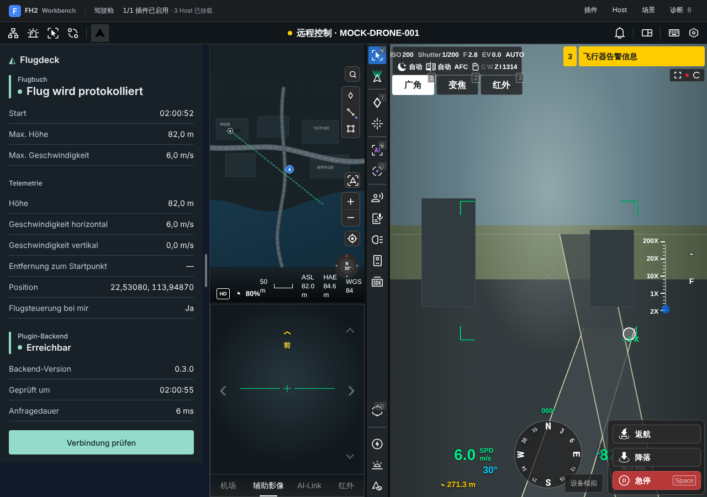

# Flugdeck für DJI FlightHub 2

Das Cockpit-Panel **Flugdeck** prüft beim Öffnen und über **Verbindung prüfen**, ob sein Backend erreichbar ist. Bei Erfolg zeigt es die vom Handler gemeldete Version sowie Uhrzeit und Dauer der Prüfung. Nach acht Sekunden meldet der DJI-Aufruf eine Zeitüberschreitung. Während der Prüfung zeigt das Panel den Ladezustand. Nach einem Fehler lässt sich die Verbindung mit **Erneut prüfen** testen. Die angezeigte Version beschreibt ausschließlich das Plugin.

Unter **Gerätecheck → Ihre Geräte** lassen sich RC Pro Enterprise, RC Plus 2 Enterprise sowie Mavic 3E, 3T, 3M und Matrice 4T auswählen. Die Zuordnung markiert laut DJI kompatible und nicht kompatible Controller-Fluggerät-Kombinationen und nennt relevante Karten- und Medienmodule. Diese Profile sind Planungshilfen; sie erkennen keine aktuelle Kopplung und aktivieren keine Modul-API. Unter **Dock 4 Referenz** lassen sich für die Cloud-API-v1.20-Topologie O4 Ground Station → Dock 4 → Matrice 5TD der O4-Betriebsmodus und drei Firmwareversionen manuell prüfen. Fehlende Werte bleiben **unbekannt**, zu alte oder ungültige Werte werden als nicht erfüllt markiert. Die Versionsprüfung liest keine Geräte aus, bestätigt keine Verbindung und gibt keinen Flug frei. Eingaben werden nur während der geöffneten Panel-Sitzung gehalten.

Unter **Gerätecheck → Simulation** bildet eine lokale Zustandsfolge O4-Gateway, Dock 4 und Matrice 5TD ab: verbunden, Aufgaben-Vorbereitung, Betrieb, Abschluss und Rückkehr in den Leerlauf. Ein Verbindungsverlust setzt alle Gerätewerte auf **Unbekannt**; die Wiederherstellung nimmt die vorherige Aufgabe nicht automatisch wieder auf. Die Simulation ist illustrativ: Sie erzeugt weder DJI-Protokollnachrichten noch reale Telemetrie, Steuerbefehle oder Flugfreigaben. Sie benötigt keine Zugangsdaten und läuft nur im geöffneten Panel.

**Installationspaket:** [Flugdeck-FH2-0.3.1-Plugin.zip](packages/Flugdeck-FH2-0.3.1-Plugin.zip).



## Inbetriebnahme

Voraussetzungen sind Git, Node.js 20 ab 20.19, Node.js 22 ab 22.12 oder Node.js 24, Corepack und pnpm 10.15.0. Die relative Anordnung ist wichtig: Die Plugin-Abhängigkeiten verweisen auf die lokal gebaute DJI-Toolchain. Die folgenden Befehle beginnen in einem Entwicklungsverzeichnis, in dem beide Repositories als Nachbarn liegen.

```bash
git clone https://github.com/mason82-dotcom/FlugDeck.git
git clone https://github.com/dji-sdk/FlightHub-2-Plugin.git
git -C FlightHub-2-Plugin checkout --detach f2947c90670c2e3382ead6e8d9ab68c9170c3fa9
cd FlightHub-2-Plugin
corepack enable pnpm
pnpm --version
pnpm install --frozen-lockfile
NODE_OPTIONS=--max-old-space-size=4096 pnpm build:tooling

cd ../FlugDeck
pnpm install --frozen-lockfile
pnpm run generate
pnpm run validate
pnpm run typecheck
pnpm test
pnpm run pack
pnpm run dev
```

Öffne die vom Entwicklungsserver ausgegebene lokale Adresse. Im Mock Host über eine Gerätekarte das virtuelle Cockpit öffnen und links **Flugdeck** auswählen. Erwartet wird **Erreichbar** mit Backend-Version **0.3.1**. Bei einer unterbrochenen Anfrage erscheint eine Fehlermeldung. Nach Wiederherstellung der Verbindung prüft der Button erneut. Unter **Gerätecheck → Ihre Geräte** die vorhandene Controller-Fluggerät-Kombination auswählen. Unter **Dock 4 Referenz** führen nur der externe Dock-Modus und alle drei Mindestversionen zu **Versionsprüfung bestanden**. Unter **Simulation** die Schritte manuell auslösen und Verbindungsverlust sowie Wiederherstellung prüfen.

## Aufbau

| Bestandteil | Aufgabe |
| --- | --- |
| `packages.json` und `exp_flugdeck/capabilities.json` | Paket und zugehörige Capability deklarieren |
| `frontend/exp_flugdeck_frontend/src/plugin.ts` | Cockpit-Erweiterung anmelden, Status halten und den Gateway-Aufruf ausführen |
| `src/views/status-panel/` im Frontend | Vue-Panel über den typisierten View-Vertrag anbinden |
| `src/views/status-panel/device-check.ts` | Geräteprofile, Controllerzuordnung und Cloud-API-v1.20-Mindestversionen lokal auswerten |
| `src/views/status-panel/dock4-simulator.ts` | Rein lokale, schrittweise Dock-4-Zustände und Verbindungsverlust modellieren |
| `backend/exp_flugdeck_backend/handlers/flugdeck/status.ts` | Versionsauskunft für `flugdeck.status` liefern |

Die Member liegen unter `exp_flugdeck/`. Der Entry ruft `ctx.apiCall('/plugin/invoke', …)` mit der Backend-ID `exp_flugdeck_backend` auf. Das Frontend deklariert ausschließlich `platform:http`. Das Backend hat eine leere Allowlist und enthält weder Ereignisabonnements noch Workflows. Authentifizierung und Routing übernimmt der DJI-Host.

[Projektprüfung und offene DJI-Befunde](docs/pruefung-0.2.1.md)

[DJI On-Premises: Versionshinweise, Anmeldung und OpenAPI V2.0 im Abgleich](docs/dji-on-premises-referenz-2026-11-08.md) · [DJI Cloud API v1.20 und Cloud API 2 im Abgleich](docs/dji-cloud-api-referenz-2026-11-08.md)

## Prüfen und verpacken

Die Tests decken Host-Auswahl, Doppelklick, Zeitüberschreitung, Gatewayfehler, Wiederholung und das Entladen während einer Anfrage ab. Der Gerätecheck testet Controllerzuordnung, Versionsvergleich, fehlende/ungültige Angaben, Modus und die Zustandsanzeige im gemounteten Vue-Panel. Die Simulation prüft die Zustandsfolge, Verbindungsverlust, das Verwerfen veralteter Werte und die sichtbare Offline-Kennzeichnung. Uhrzeit und Anfragedauer beziehen sich auf den letzten abgeschlossenen Backend-Aufruf, einschließlich Fehlerantworten. Eine Prüfung im echten DJI-Cockpit und an realer Hardware steht aus.

Die Zuordnung RC Plus 2 Enterprise/Matrice 4T und die Nichtunterstützung von Mavic 3 Enterprise durch RC Plus 2 stehen in der [DJI Matrice 4 FAQ](https://enterprise.dji.com/matrice-4-series/faq). Die [Mavic 3 Enterprise Spezifikation](https://enterprise.dji.com/mavic-3-enterprise/specs) benennt RC Pro Enterprise und Mavic 3E/3T; [DJI Mavic 3M](https://enterprise.dji.com/mavic-3-m) nennt RC Pro Enterprise und Multispektral. Die Cloud-Funktionsdeckung einzelner Modelle muss am jeweiligen DJI-Protokoll und Zielmandanten gesondert geprüft werden.

`pnpm run pack` gibt bei Erfolg `UPLOAD_READY` und den Pfad zur ZIP-Datei aus. Die Installation im DJI-Zielmandanten und die visuelle Prüfung im echten Cockpit stehen aus.

[DJI-Plattformarchitektur](https://github.com/dji-sdk/FlightHub-2-Plugin/blob/f2947c90670c2e3382ead6e8d9ab68c9170c3fa9/docs/cn/90.plugin-development/30.detailed-guide/10.concepts/20.platform-architecture.md) · [SDK-Aufruf und Lebenszyklus](https://github.com/dji-sdk/FlightHub-2-Plugin/blob/f2947c90670c2e3382ead6e8d9ab68c9170c3fa9/packages/fh2-plugin-sdk/src/contracts/context.ts) · [SDK-Fehlerstruktur](https://github.com/dji-sdk/FlightHub-2-Plugin/blob/f2947c90670c2e3382ead6e8d9ab68c9170c3fa9/packages/fh2-plugin-sdk/src/contracts/errors.ts)
